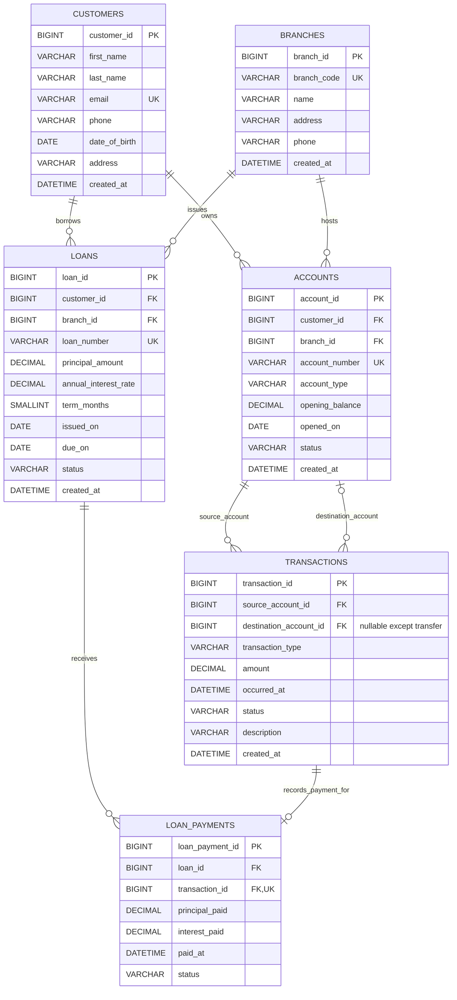

# CampusBank — Database Design Foundation

**Status:** Proposed scope and database design, pending project-owner approval  
**Purpose:** Academic banking simulation using sample data. This is not a production banking platform.

## 1. Project scope

### In scope

- Maintain customer and branch records.
- Open and manage customer accounts assigned to branches.
- Record deposits, withdrawals, and transfers between accounts, with transaction history and balance reporting.
- Maintain loan records and record loan repayments.
- Search and filter customers, accounts, transactions, loans, and repayments; produce summary reports using joins and aggregates.
- Demonstrate relational integrity, 3NF, database transactions/rollback, and later database views, stored procedures, and triggers.

### Proposed exclusions

- Real-money payment rails, card processing, interest accrual, fees, regulatory reporting, identity verification, multi-currency, and production-grade security/compliance.
- Staff administration, authentication tables, audit/event infrastructure, and a persisted role/permission model in this six-table phase. Roles below describe application access; authentication may be added separately if the project expands.
- Loan application/approval workflows and automatic loan disbursement. The phase tracks loans and repayments.

### Functional requirements

1. Create, view, update, and search customer and branch records.
2. Open an account for a customer at a branch; maintain account number, type, status, opening date, and opening balance.
3. List accounts and calculate current balances from the opening balance and posted account transactions.
4. Post a deposit or withdrawal and record amount, timestamp, status, and description; reject invalid amounts and withdrawals that exceed available balance.
5. Transfer funds between two distinct accounts as one atomic operation: validate funds, record the transfer, and commit or roll back as a unit.
6. View/filter transaction history by account, type, status, and date range.
7. Record loans for customers, including branch, principal, interest rate, term, dates, and status.
8. Record loan repayments and associate each repayment with the account transaction that debits the paying account.
9. Search loans and repayments; report account balances, transaction totals, branch/customer account summaries, loan totals, and repayment totals.
10. Enforce keys, valid references, domain checks, and uniqueness in the database. Application operations must use parameterized queries and database transactions for multi-row financial actions.

## 2. User roles

| Role | Intended capabilities |
|---|---|
| Administrator | Manage branches and customer records; view and manage accounts, loans, and transaction records; access reports. |
| Teller / Bank operator | Find customers; open/update accounts as permitted; post deposits, withdrawals, transfers, and loan repayments; view transaction history. |
| Read-only auditor / manager | View and filter records and reports without posting or editing financial operations. |
| Customer (optional demo role) | View their own profile, accounts, balances, transactions, loans, and repayments. No self-service financial posting is assumed in this phase. |

These are application-level roles. The six-table schema does not persist users or permissions; authorization must be enforced by the application if implemented.

## CampusBank extension (student finance)

The application now uses the existing `customers` entity as the student profile and adds nullable/unique `student_id`, `institution`, `department`, and `graduation_year` attributes. Existing customer keys and account/loan foreign keys remain intact. `expense_categories` separates income labels (Allowance, Scholarship, Family Support, Other Income) from expense labels (Food, Travel, Hostel, Books, College Fees, Entertainment, Other); `transactions.expense_category_id` is optional and references that lookup. Deposits may use an income category, withdrawals an expense category, and internal transfers/loan repayments remain uncategorized in this model. `savings_goals` references a student and a linked account. The API verifies that the account belongs to that student.

Savings progress is defined as `LEAST(linked account current balance, target amount)`. It is an estimate only: it does not reserve money, alter the balance, or guarantee that multiple goals linked to one account represent separate funds. Student monthly income counts posted categorized deposits; categorized posted withdrawals count as expenses. Transfers between accounts and loan repayments are excluded from that student spending total.

For an existing Phase 2+ database, apply the additive migration at `migrations/001_campusbank_student_finance.sql` once after taking a backup. It preserves existing ledger data and only backfills the known fictional seed profiles. For a fresh database, use the expanded root setup script, which creates and seeds the existing and student-finance schema without dropping a database.

## 3. ER diagram



**Cardinalities:** A customer may have zero or many accounts and loans; each account and loan belongs to exactly one customer. A branch may host zero or many accounts and issue zero or many loans; each account and loan refers to exactly one branch. A loan may have zero or many payments; each payment refers to one loan. Every transaction has one source account and may have one destination account (required for a transfer, absent for deposit/withdrawal/loan repayment). A transaction may be linked to at most one loan payment, while each loan payment is linked to exactly one transaction.

## 4. Relational schema

Types below target MySQL 8.0. Use InnoDB and `utf8mb4`. Money uses fixed-precision `DECIMAL`, never floating point. All timestamps are stored consistently (prefer UTC); application display can localize them.

```text
Customers(
  customer_id BIGINT UNSIGNED PK AI,
  first_name VARCHAR(80) NOT NULL,
  last_name VARCHAR(80) NOT NULL,
  email VARCHAR(254) NOT NULL UNIQUE,
  phone VARCHAR(32) NULL,
  date_of_birth DATE NULL,
  address VARCHAR(500) NULL,
  created_at DATETIME NOT NULL DEFAULT CURRENT_TIMESTAMP
)

Branches(
  branch_id BIGINT UNSIGNED PK AI,
  branch_code VARCHAR(20) NOT NULL UNIQUE,
  name VARCHAR(120) NOT NULL,
  address VARCHAR(500) NOT NULL,
  phone VARCHAR(32) NULL,
  created_at DATETIME NOT NULL DEFAULT CURRENT_TIMESTAMP
)

Accounts(
  account_id BIGINT UNSIGNED PK AI,
  customer_id BIGINT UNSIGNED NOT NULL FK -> Customers.customer_id,
  branch_id BIGINT UNSIGNED NOT NULL FK -> Branches.branch_id,
  account_number VARCHAR(34) NOT NULL UNIQUE,
  account_type ENUM('checking','savings','fixed_deposit') NOT NULL,
  opening_balance DECIMAL(15,2) NOT NULL DEFAULT 0.00 CHECK (opening_balance >= 0),
  opened_on DATE NOT NULL DEFAULT (CURRENT_DATE),
  status ENUM('active','frozen','closed') NOT NULL DEFAULT 'active',
  created_at DATETIME NOT NULL DEFAULT CURRENT_TIMESTAMP
)

Transactions(
  transaction_id BIGINT UNSIGNED PK AI,
  source_account_id BIGINT UNSIGNED NOT NULL FK -> Accounts.account_id,
  destination_account_id BIGINT UNSIGNED NULL FK -> Accounts.account_id,
  transaction_type ENUM('deposit','withdrawal','transfer','loan_repayment') NOT NULL,
  amount DECIMAL(15,2) NOT NULL CHECK (amount > 0),
  occurred_at DATETIME NOT NULL DEFAULT CURRENT_TIMESTAMP,
  status ENUM('pending','posted','failed','reversed') NOT NULL DEFAULT 'posted',
  description VARCHAR(500) NULL,
  created_at DATETIME NOT NULL DEFAULT CURRENT_TIMESTAMP,
  CHECK (source_account_id <> destination_account_id OR destination_account_id IS NULL),
  CHECK ((transaction_type = 'transfer' AND destination_account_id IS NOT NULL)
      OR (transaction_type <> 'transfer' AND destination_account_id IS NULL))
)

Loans(
  loan_id BIGINT UNSIGNED PK AI,
  customer_id BIGINT UNSIGNED NOT NULL FK -> Customers.customer_id,
  branch_id BIGINT UNSIGNED NOT NULL FK -> Branches.branch_id,
  loan_number VARCHAR(34) NOT NULL UNIQUE,
  principal_amount DECIMAL(15,2) NOT NULL CHECK (principal_amount > 0),
  annual_interest_rate DECIMAL(7,4) NOT NULL DEFAULT 0.0000 CHECK (annual_interest_rate >= 0),
  term_months SMALLINT UNSIGNED NOT NULL CHECK (term_months > 0),
  issued_on DATE NOT NULL,
  due_on DATE NOT NULL,
  status ENUM('pending','active','paid','defaulted','cancelled') NOT NULL DEFAULT 'active',
  created_at DATETIME NOT NULL DEFAULT CURRENT_TIMESTAMP,
  CHECK (due_on >= issued_on)
)

LoanPayments(
  loan_payment_id BIGINT UNSIGNED PK AI,
  loan_id BIGINT UNSIGNED NOT NULL FK -> Loans.loan_id,
  transaction_id BIGINT UNSIGNED NOT NULL UNIQUE FK -> Transactions.transaction_id,
  principal_paid DECIMAL(15,2) NOT NULL DEFAULT 0.00 CHECK (principal_paid >= 0),
  interest_paid DECIMAL(15,2) NOT NULL DEFAULT 0.00 CHECK (interest_paid >= 0),
  paid_at DATETIME NOT NULL DEFAULT CURRENT_TIMESTAMP,
  status ENUM('pending','posted','failed','reversed') NOT NULL DEFAULT 'posted',
  CHECK (principal_paid + interest_paid > 0)
)
```

### Integrity and operational notes

- Foreign keys should use `ON DELETE RESTRICT` for financial and customer/branch history. Correct mistakes through status changes/reversal records rather than cascading deletion. Reference/master records can be marked closed/inactive rather than deleted.
- Useful indexes: `Accounts(customer_id)`, `Accounts(branch_id)`, `Transactions(source_account_id, occurred_at)`, `Transactions(destination_account_id, occurred_at)`, `Transactions(status, occurred_at)`, `Loans(customer_id, status)`, `Loans(branch_id, status)`, and `LoanPayments(loan_id, paid_at)`. Unique keys already index account, loan, branch, and customer identifiers.
- Current balance is intentionally not stored in `Accounts`: calculate as opening balance plus posted deposits and incoming transfers, minus posted withdrawals, outgoing transfers, and loan-repayment debits. This avoids a duplicated balance that can drift. For a transfer, `amount` is debited from the source and credited to the destination. Failed, pending, and reversed records do not contribute. If performance later requires a cached balance, treat it as a controlled derived value and reconcile it against the ledger.
- A loan repayment produces one posted `Transactions` row of type `loan_repayment` (source account is the paying account; destination is `NULL`) and one corresponding `LoanPayments` row. Require the transaction type to match, and validate `principal_paid + interest_paid = amount` in the same application/database operation; a row-level `CHECK` cannot enforce cross-table equality.
- MySQL `CHECK` constraints are enforced in supported modern versions (MySQL 8.0.16+). Cross-row rules (sufficient funds, matching loan payment and transaction, cumulative payments not exceeding the amount owed, immutable posted ledger entries) need transactional service logic and/or stored procedures/triggers. Use row locks or equivalent concurrency control when checking/updating balances.
- A transfer should be atomic. With this single-row transfer representation, insert one transfer transaction only after locking/validating both account records; balance calculations treat it as a debit and credit pair. Commit all related changes together, or roll back. Future double-entry accounting would model a transfer as two ledger entries and is outside this six-table introductory scope.
- SQL reserved word `TRANSACTION` is avoided as a physical table name; the logical entity is Transactions and the physical name is `transactions` (or `bank_transactions` if the target SQL environment requires quoting).

## 5. Normalization through 3NF

The schema is designed to satisfy 3NF:

1. **First Normal Form (1NF):** Each column holds one value of its declared type; records have primary keys; repeating groups (multiple accounts, transactions, payments) are separate rows in their own relations. Contact details are individual attributes rather than packed lists.
2. **Second Normal Form (2NF):** Every relation has a single-column primary key. Non-key attributes depend on the whole key; there are no partial dependencies on part of a composite key.
3. **Third Normal Form (3NF):** Non-key attributes describe only the key of their own table. Customer details are kept in `Customers`, branch details in `Branches`, account details in `Accounts`, loan details in `Loans`, and repayment details in `LoanPayments`. Foreign keys reference those facts instead of copying customer or branch names into account/loan rows. `Transactions` stores the movement facts and references account identifiers rather than embedding account/customer data.

`Accounts` does not store a mutable current balance because it is derivable from the opening balance and posted transaction rows. Loan outstanding balances and aggregate report totals are also derived from principal and payment rows rather than duplicated. This avoids update anomalies and keeps the base relations normalized.

## 6. Approval checklist and deliverables

- [x] Draft functional scope and user roles.
- [x] Draft ER diagram with entities, attributes, keys, and cardinalities.
- [x] Define six core relations with primary keys, foreign keys, unique constraints, checks, and defaults.
- [x] Document normalization through 3NF and derived-value decisions.
- [ ] Project owner approval of scope and design.

This document is the proposed Phase 1 deliverable. Approval is pending; changes to account ownership (joint accounts), transaction modeling, authentication, loan workflow, or balance handling should be agreed before implementation.
