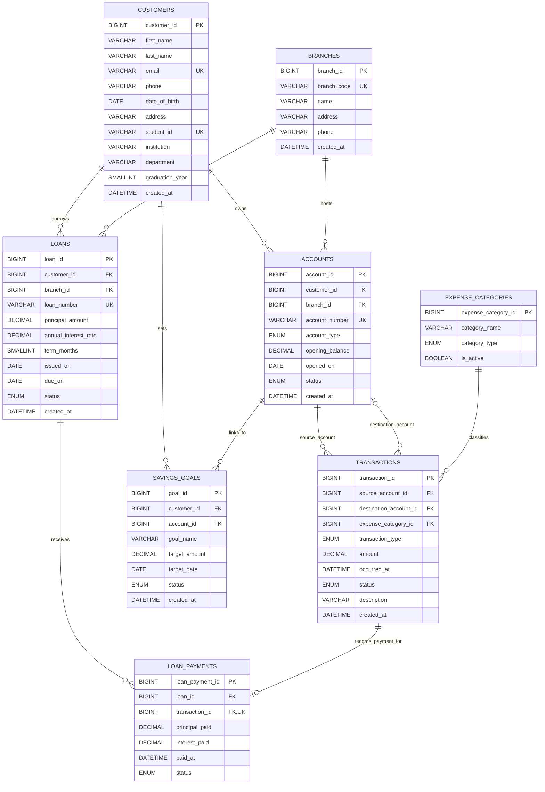

# CampusBank — Student Banking & Personal Finance Management System

> **DBMS Mini Project** · Relational Database Management System (MySQL 8.0)  
> Academic simulation exploring transaction processing, concurrency control, 3NF normalization, stored procedures, triggers, and full-stack integration.

[](https://www.mysql.com/)
[](https://nodejs.org/)
[](https://react.dev/)
[](#normalization-through-3nf)
[](#testing--verification)

---

## 📋 Table of Contents

1. [Project Overview](#project-overview)
2. [Key DBMS Features & Architecture](#key-dbms-features--architecture)
3. [Entity-Relationship (ER) Model](#entity-relationship-er-model)
4. [Relational Schema & Constraints](#relational-schema--constraints)
5. [Normalization through 3NF](#normalization-through-3nf)
6. [Advanced Database Objects](#advanced-database-objects)
   - [Dynamic Balance View (`AccountSummaryView`)](#1-dynamic-balance-view-accountsummaryview)
   - [Atomic Stored Procedure (`TransferFunds`)](#2-atomic-stored-procedure-transferfunds)
   - [Integrity Triggers](#3-integrity-triggers)
   - [Automated Constraint Test Suite](#4-automated-constraint-test-suite)
7. [Student Finance Extensions](#student-finance-extensions)
8. [REST API Endpoints](#rest-api-endpoints)
9. [Setup & Installation Guide](#setup--installation-guide)
10. [Testing & Verification](#testing--verification)
11. [Viva Voce & Evaluation FAQ](#viva-voce--evaluation-faq)

---

## 🎯 Project Overview

**CampusBank** is an academic database management system and full-stack web application designed to simulate campus-oriented retail banking and student personal finance. 

Traditional banking platforms often model static account balances, risking data drift and update anomalies. CampusBank addresses this fundamental database challenge by implementing an **append-only ledger** where account balances are **derived mathematically** from the initial opening balance and posted immutable transactions.

### Academic Objectives:
- Demonstrate strict **Third Normal Form (3NF)** relational database design.
- Enforce strict **domain integrity**, **referential integrity**, and **business rules** at both database and application tiers.
- Guarantee **ACID properties** across multi-row financial transactions (such as intra-bank fund transfers and loan repayments).
- Prevent race conditions and deadlocks using **deterministic row-level locking (`FOR UPDATE`)**.
- Provide transparent student budgeting insights: categorized allowances, scholarships, campus spending, and balance-linked savings goals.

> [!NOTE]
> CampusBank is an academic simulation using synthetic/fictional records. It does not connect to actual payment rails (ACH, UPI, SWIFT) or process real currency.

---

## 🏛 Key DBMS Features & Architecture

```
┌─────────────────────────────────────────────────────────────┐
│                 React 18 Single-Page App                   │
│   Overview · Students · Accounts · Ledger · Goals · Loans   │
└──────────────────────────────┬──────────────────────────────┘
                               │ JSON / REST API (port 3001)
┌──────────────────────────────▼──────────────────────────────┐
│                    Express.js REST API                      │
│   Input Sanitization · Validation · Connection Pool Manager │
└──────────────────────────────┬──────────────────────────────┘
                               │ Parameterized SQL queries
┌──────────────────────────────▼──────────────────────────────┐
│                     MySQL 8.0 Engine                        │
│ ┌──────────────────────┐  ┌───────────────────────────────┐ │
│ │  InnoDB Tables (3NF) │  │  Views & Triggers             │ │
│ │  - customers         │  │  - AccountSummaryView         │ │
│ │  - accounts          │  │  - trg_transactions_category  │ │
│ │  - transactions      │  │  - trg_transactions_validate  │ │
│ │  - expense_categories│  │  - trg_loan_payments_validate │ │
│ │  - savings_goals     │  └───────────────────────────────┘ │
│ │  - loans             │  ┌───────────────────────────────┐ │
│ │  - loan_payments     │  │  Stored Procedures            │ │
│ │  - branches          │  │  - TransferFunds              │ │
│ └──────────────────────┘  │  - TestExpectedConstraints    │ │
│                           └───────────────────────────────┘ │
└─────────────────────────────────────────────────────────────┘
```

1. **Storage Engine:** MySQL InnoDB with row-level locking and full foreign key support.
2. **Character Set & Collation:** `utf8mb4` with `utf8mb4_0900_ai_ci`.
3. **Ledger Precision:** Monetary values stored as `DECIMAL(15,2)` to prevent floating-point rounding errors.
4. **Deadlock Prevention:** Concurrent opposing fund transfers lock participant account rows in strictly ascending `account_id` order.
5. **No Orphan Balances:** Balances are not stored as mutable columns in `accounts`. Instead, `AccountSummaryView` calculates net funds on demand from posted ledger rows.

---

## 📊 Entity-Relationship (ER) Model



---

## 🗄 Relational Schema & Constraints

### 1. `customers`
Stores primary profile details for students/clients.
- `customer_id`: `BIGINT UNSIGNED AUTO_INCREMENT PRIMARY KEY`
- `first_name`, `last_name`: `VARCHAR(80) NOT NULL`
- `email`: `VARCHAR(254) NOT NULL UNIQUE`
- `student_id`: `VARCHAR(40) NULL UNIQUE` (Student roll number / identifier)
- `institution`: `VARCHAR(180) NULL`
- `department`: `VARCHAR(120) NULL`
- `graduation_year`: `SMALLINT UNSIGNED NULL CHECK (graduation_year BETWEEN 2000 AND 2200)`

### 2. `branches`
Physical or regional banking branch locations.
- `branch_id`: `BIGINT UNSIGNED AUTO_INCREMENT PRIMARY KEY`
- `branch_code`: `VARCHAR(20) NOT NULL UNIQUE` (e.g. `BR-NORTH`, `BR-CAMPUS`)
- `name`: `VARCHAR(120) NOT NULL`
- `address`: `VARCHAR(500) NOT NULL`

### 3. `accounts`
Deposit accounts owned by students and hosted at branches.
- `account_id`: `BIGINT UNSIGNED AUTO_INCREMENT PRIMARY KEY`
- `customer_id`: `BIGINT UNSIGNED NOT NULL REFERENCES customers(customer_id)`
- `branch_id`: `BIGINT UNSIGNED NOT NULL REFERENCES branches(branch_id)`
- `account_number`: `VARCHAR(34) NOT NULL UNIQUE`
- `account_type`: `ENUM('checking', 'savings', 'fixed_deposit') NOT NULL`
- `opening_balance`: `DECIMAL(15,2) NOT NULL DEFAULT 0.00 CHECK (opening_balance >= 0)`
- `status`: `ENUM('active', 'frozen', 'closed') NOT NULL DEFAULT 'active'`

### 4. `expense_categories`
Lookup relation classifying transactions into student budgets.
- `expense_category_id`: `BIGINT UNSIGNED AUTO_INCREMENT PRIMARY KEY`
- `category_name`: `VARCHAR(60) NOT NULL`
- `category_type`: `ENUM('income', 'expense') NOT NULL`
- `is_active`: `BOOLEAN NOT NULL DEFAULT TRUE`
- Unique constraint: `UNIQUE (category_type, category_name)`

### 5. `transactions`
Append-only financial ledger of all credit, debit, and transfer events.
- `transaction_id`: `BIGINT UNSIGNED AUTO_INCREMENT PRIMARY KEY`
- `source_account_id`: `BIGINT UNSIGNED NOT NULL REFERENCES accounts(account_id)`
- `destination_account_id`: `BIGINT UNSIGNED NULL REFERENCES accounts(account_id)`
- `expense_category_id`: `BIGINT UNSIGNED NULL REFERENCES expense_categories(expense_category_id)`
- `transaction_type`: `ENUM('deposit', 'withdrawal', 'transfer', 'loan_repayment') NOT NULL`
- `amount`: `DECIMAL(15,2) NOT NULL CHECK (amount > 0)`
- `status`: `ENUM('pending', 'posted', 'failed', 'reversed') NOT NULL DEFAULT 'posted'`
- **Constraint `chk_transactions_distinct_accounts`:** Ensures `source_account_id <> destination_account_id`.
- **Constraint `chk_transactions_transfer_destination`:** Destination is required for transfers, and must be `NULL` for deposits, withdrawals, and loan payments.

### 6. `savings_goals`
Student-defined savings targets linked to active bank accounts.
- `goal_id`: `BIGINT UNSIGNED AUTO_INCREMENT PRIMARY KEY`
- `customer_id`: `BIGINT UNSIGNED NOT NULL REFERENCES customers(customer_id)`
- `account_id`: `BIGINT UNSIGNED NOT NULL REFERENCES accounts(account_id)`
- `target_amount`: `DECIMAL(15,2) NOT NULL CHECK (target_amount > 0)`
- `status`: `ENUM('active', 'completed', 'cancelled') NOT NULL DEFAULT 'active'`

### 7. `loans` & `loan_payments`
Education loan records and payment ledger.
- `loans.principal_amount`: `DECIMAL(15,2) NOT NULL CHECK (principal_amount > 0)`
- `loans.annual_interest_rate`: `DECIMAL(7,4) NOT NULL CHECK (annual_interest_rate >= 0)`
- `loan_payments.transaction_id`: `BIGINT UNSIGNED NOT NULL UNIQUE` (Guarantees every loan payment has an exact corresponding debit transaction).
- `CHECK (principal_paid + interest_paid > 0)` and `CHECK (due_on >= issued_on)`.

---

## 📐 Normalization through 3NF

The database was systematically normalized to eliminate insertion, update, and deletion anomalies:

1. **First Normal Form (1NF):**
   - Every column contains atomic (indivisible) scalar values.
   - Repeating groups (e.g. multiple transactions per account) are factored into independent relations.
   - Each record is uniquely identified by a single-column primary key (`account_id`, `transaction_id`, etc.).

2. **Second Normal Form (2NF):**
   - The relations are in 1NF.
   - All primary keys are single-attribute surrogate keys (`customer_id`, `branch_id`, etc.), meaning partial functional dependencies cannot exist ($X \to Y$ where $X \subset PK$). Every non-key attribute is fully functionally dependent on the entire primary key.

3. **Third Normal Form (3NF):**
   - The relations are in 2NF.
   - There are **no transitive dependencies** ($A \to B$ and $B \to C$).
   - *Example:* `accounts` stores `customer_id` and `branch_id` as foreign keys rather than storing the customer's name, email, or branch address directly. Customer and branch facts depend solely on `customer_id` and `branch_id` in their respective parent tables.
   - *Derived Balance Decision:* `accounts` does not contain a mutable `current_balance` attribute. A stored balance would depend on transaction history, creating transitive update anomalies whenever transactions are inserted or reversed. Balances are derived dynamically via `AccountSummaryView`.

---

## ⚡ Advanced Database Objects

### 1. Dynamic Balance View (`AccountSummaryView`)

Computes real-time account balances on demand using an efficient aggregate query over posted ledger entries:

```sql
CREATE VIEW AccountSummaryView AS
SELECT a.account_id, a.account_number, a.customer_id, a.branch_id,
       a.account_type, a.status AS account_status, a.opening_balance,
       a.opening_balance + COALESCE(SUM(movement.delta), 0.00) AS current_balance
FROM accounts AS a
LEFT JOIN (
  SELECT source_account_id AS account_id,
         CASE transaction_type
           WHEN 'deposit' THEN amount
           WHEN 'withdrawal' THEN -amount
           WHEN 'loan_repayment' THEN -amount
           WHEN 'transfer' THEN -amount
         END AS delta
  FROM transactions WHERE status = 'posted'
  UNION ALL
  SELECT destination_account_id AS account_id, amount AS delta
  FROM transactions
  WHERE status = 'posted' AND transaction_type = 'transfer'
) AS movement ON movement.account_id = a.account_id
GROUP BY a.account_id, a.account_number, a.customer_id, a.branch_id,
         a.account_type, a.status, a.opening_balance;
```

### 2. Atomic Stored Procedure (`TransferFunds`)

Executes intra-bank fund transfers with strict ACID guarantees:
- **Ascending ID Locking:** Compares `p_source_account_id` and `p_destination_account_id` and executes `SELECT ... FOR UPDATE` in strict ascending order, preventing deadlocks when two users transfer money to each other simultaneously.
- **Pre-transfer Validation:** Verifies both accounts exist, are active, and checks available funds via `AccountSummaryView`.
- **Automatic Rollback:** Uses an `SQLEXCEPTION` exit handler to abort the transaction if any step fails.

```sql
CALL TransferFunds(2, 3, 25.00, 'Demo transfer between student accounts');
```

### 3. Integrity Triggers

- **`trg_transactions_category_before_insert`:** Ensures that a deposit can only reference an `income` category, and a withdrawal can only reference an `expense` category.
- **`trg_transactions_validate_before_insert`:** Ensures source and destination accounts exist and are in `active` status before a transaction is inserted.
- **`trg_loan_payments_validate_before_insert`:** Verifies that a payment record matches its corresponding `loan_repayment` transaction in status and amount (`principal_paid + interest_paid = amount`).

### 4. Automated Constraint Test Suite

`TestExpectedConstraintFailures()` automatically verifies database constraints at setup time, attempting invalid operations (e.g. invalid foreign keys, negative amounts, transfers without destinations, overdrafts) and verifying that the database raises the appropriate `SQLSTATE 45000` errors.

---

## 🎓 Student Finance Extensions

CampusBank tailors retail banking specifically for university life:
- **Student Profiles:** Extends customer data with `student_id`, `institution`, `department`, and `graduation_year`.
- **Budgeting Categories:**
  - *Income:* Allowance, Scholarship, Family Support, Other Income.
  - *Expenses:* Food, Travel, Hostel, Books, College Fees, Entertainment, Other.
- **Student Monthly Cash Flow:** Generates monthly statements calculating total categorized income vs. eligible student spending, intentionally excluding internal account transfers.
- **Balance-Linked Savings Goals:** Allows students to create goals (e.g. "Laptop Fund", "Internship Travel") linked to their active accounts. The progress is computed dynamically as:
  $$\text{Progress} = \min(\text{Current Balance}, \text{Target Amount})$$
  *(Funds are not earmarked or locked, preserving real-world banking flexibility).*

---

## 🌐 REST API Endpoints

The backend is built with Express.js, providing parameterized SQL queries and uniform JSON error payloads.

| Method | Endpoint | Description |
|---|---|---|
| `GET` | `/api/health` | Health check verifying MySQL connectivity |
| `GET` | `/api/students` | List student profiles (supports `?q=` search) |
| `POST` | `/api/students` | Register a new student profile |
| `GET` | `/api/students/:id` | Retrieve student profile details |
| `PATCH`| `/api/students/:id` | Update student profile fields |
| `GET` | `/api/accounts` | List accounts (supports `?customerId=`, `?status=`) |
| `POST` | `/api/accounts` | Open an account for a student at a branch |
| `PATCH`| `/api/accounts/:id` | Update account status (`active`, `frozen`, `closed`) |
| `GET` | `/api/account-summary` | Fetch all accounts with live calculated balances |
| `GET` | `/api/transactions` | Search transactions (supports date, type, category, status) |
| `POST` | `/api/transactions/deposit` | Post a deposit with optional income category |
| `POST` | `/api/transactions/withdrawal` | Post a withdrawal with optional expense category |
| `POST` | `/api/transactions/transfer` | Atomic transfer between accounts |
| `GET` | `/api/savings-goals` | List savings goals with calculated progress (`?studentId=`) |
| `POST` | `/api/savings-goals` | Create a savings goal linked to an account |
| `PATCH`| `/api/savings-goals/:id` | Update goal target amount, date, or status |
| `DELETE`| `/api/savings-goals/:id`| Remove a savings goal |
| `GET` | `/api/loans` | List education loans |
| `POST` | `/api/loans` | Create a loan record |
| `POST` | `/api/payments` | Record loan repayment with linked account debit |
| `GET` | `/api/reports/students/:id/monthly` | Student monthly income & expense summary |
| `GET` | `/api/reports/summary` | Branch metrics and loan portfolio breakdown |
| `GET` | `/api/reports/daily-transactions` | Daily volume aggregation for charts (`?days=`) |

---

## 🚀 Setup & Installation Guide

### Prerequisites
- **Node.js**: v20 or higher
- **MySQL Server**: 8.0 or higher
- **npm**: v10+

### Step 1: Database Setup

1. Launch your MySQL client (Workbench, CLI, or phpMyAdmin) with privileges to create databases.
2. Execute the primary SQL script:
   ```bash
   mysql -u root -p < bank_management.sql
   ```
   > [!TIP]
   > For an existing Phase 1 database, apply the non-destructive migration script instead:  
   > `mysql -u root -p bank_management < migrations/001_campusbank_student_finance.sql`

### Step 2: Backend Configuration & Startup

1. Open `backend/.env` (or copy from `backend/.env.example`):
   ```ini
   PORT=3001
   DB_HOST=127.0.0.1
   DB_PORT=3306
   DB_USER=root
   DB_PASSWORD=your_mysql_password
   DB_NAME=bank_management
   DB_CONNECTION_LIMIT=10
   ```
2. Install dependencies and start the backend:
   ```bash
   cd backend
   npm ci
   npm start
   ```
3. Test connectivity:
   ```bash
   curl http://localhost:3001/api/health
   # Expected response: {"status":"ok","database":"connected"}
   ```

### Step 3: Frontend Setup & Startup

1. Open a new terminal and navigate to `frontend/`:
   ```bash
   cd frontend
   npm ci
   npm run dev
   ```
2. Open your browser and navigate to:  
   👉 **`http://localhost:5173`**

---

## 🧪 Testing & Verification

### Running Automated API Tests
The backend includes a 15-test automated suite checking input validation, parameterized query isolation, transaction rollback on failure, and concurrency locking:

```bash
npm run backend:test
```

### Verified Test Cases:
- ✔ Rejects unknown / malicious SQL injection fields prior to query dispatch.
- ✔ Parameterizes transaction queries with bound values.
- ✔ Full CRUD validation for students, accounts, loans, and goals.
- ✔ Rejects savings goals linked to accounts not owned by the student.
- ✔ Atomic transfer locks accounts in stable order and commits one transaction row.
- ✔ Rejects transfers when balance is insufficient and rolls back changes.
- ✔ Rejects category mismatch (e.g. deposit with an expense category).
- ✔ Rejects withdrawals on frozen/closed accounts.

---

## 👥 Contributors & Academic Context

- **Course:** Database Management Systems (DBMS) Mini Project  
- **Database:** MySQL 8.0+ / InnoDB  
- **Architecture:** 3-Tier Web Application (React + Express + MySQL)

